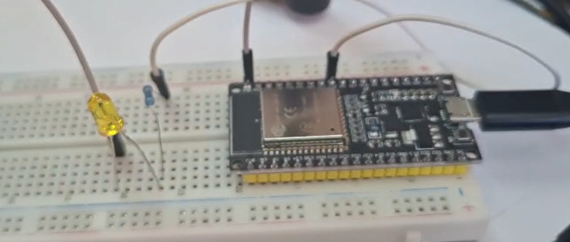
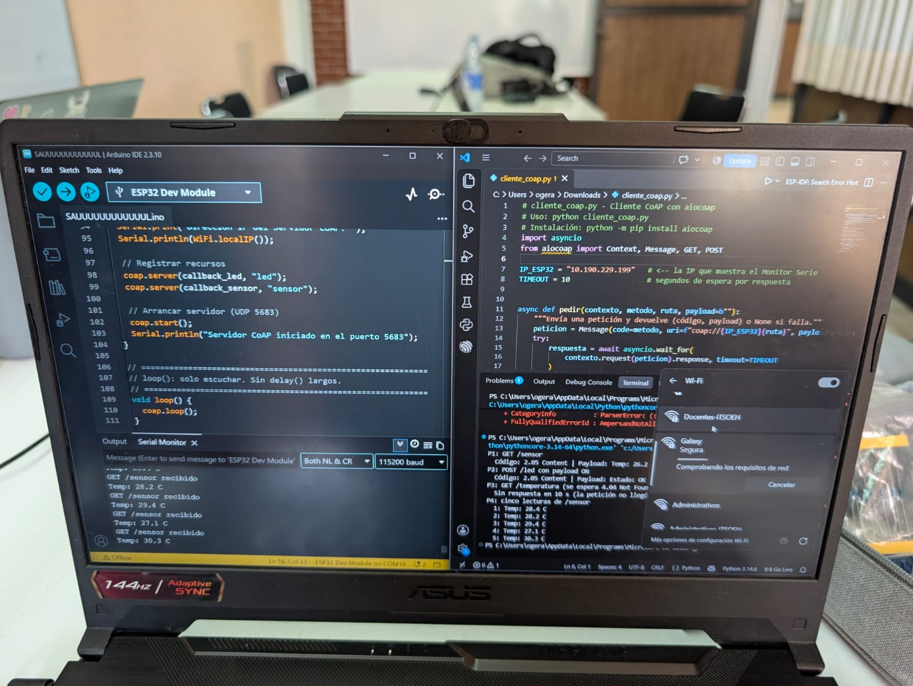
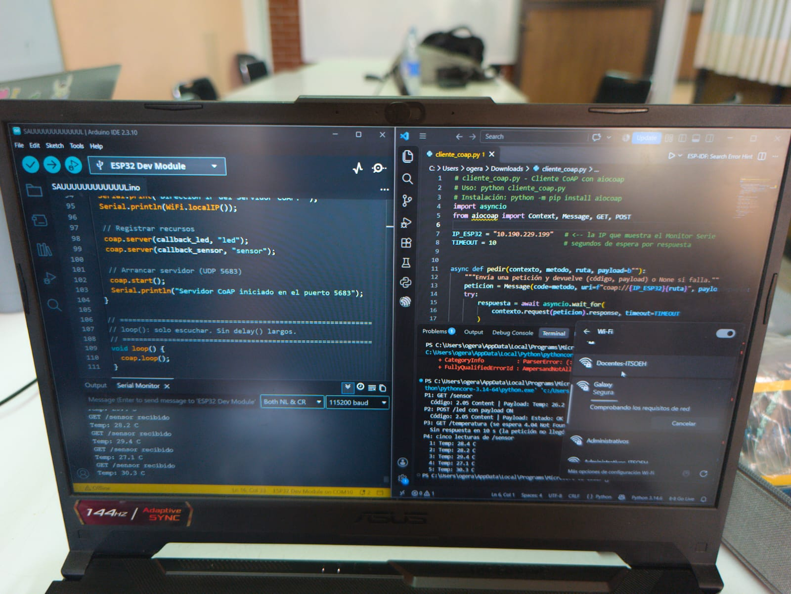
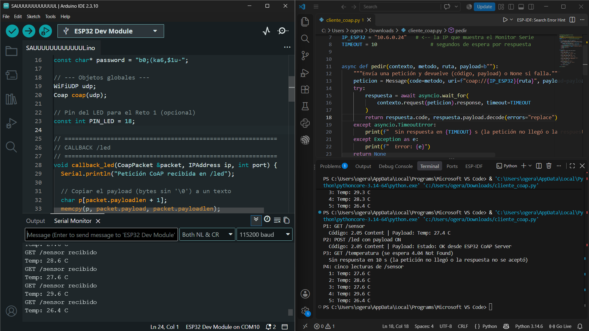
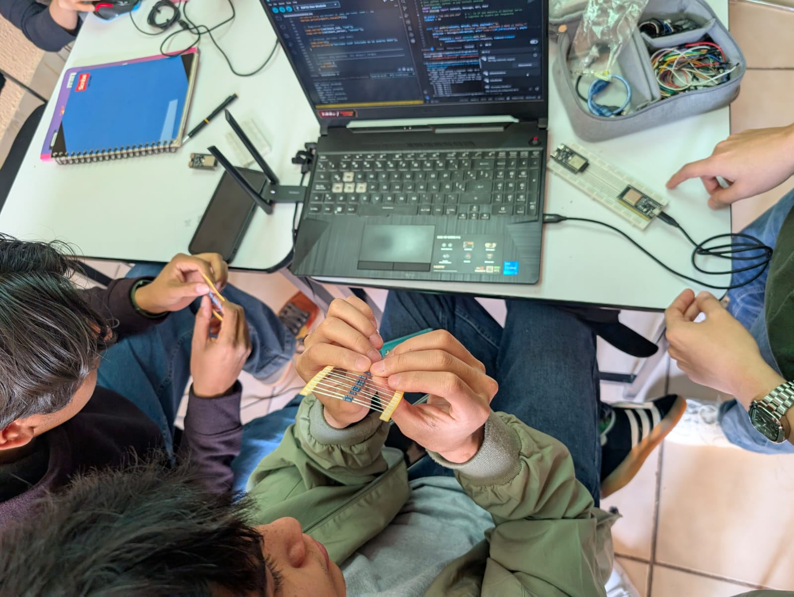
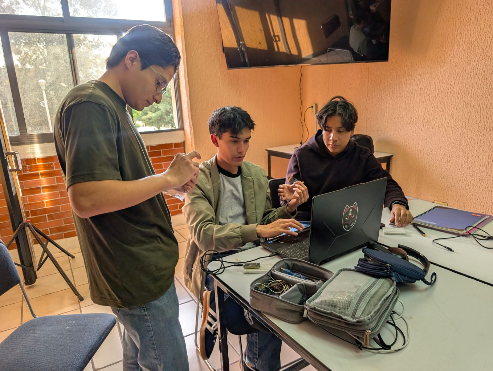
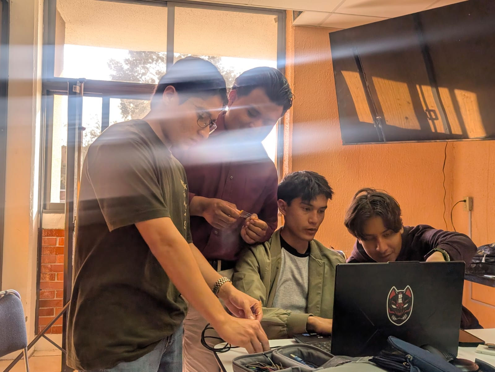
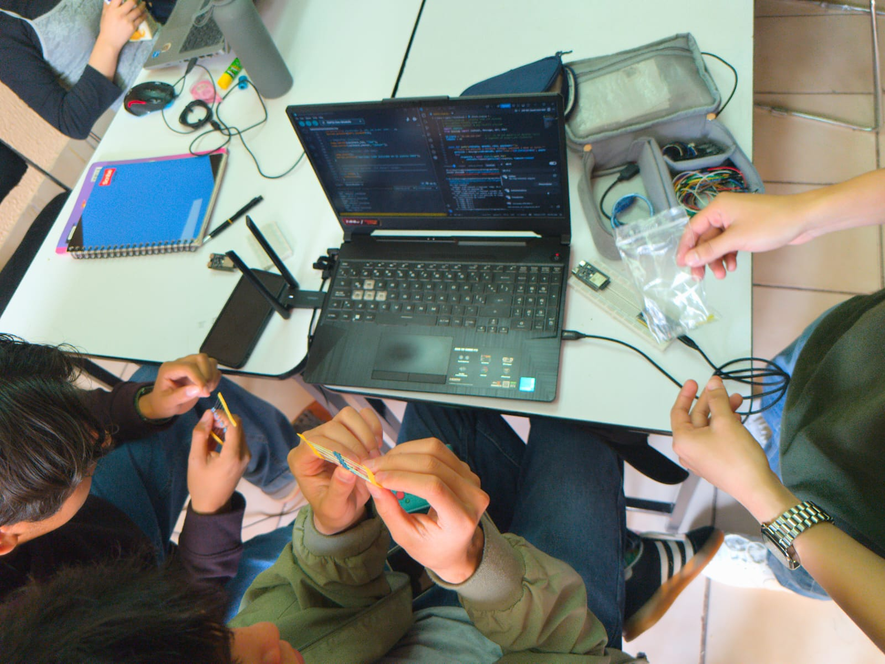

# Servidor CoAP en ESP32 (`/sensor` y `/led`)

Práctica de laboratorio: un ESP32 que funciona como **servidor CoAP** sobre UDP (puerto 5683) con dos recursos, y un **cliente en Python** (`aiocoap`) para probarlo.

<a id="indice"></a>

## Índice

- [Objetivos](#objetivos)
- [Estructura del repositorio](#estructura-del-repositorio)
- [1. ¿Por qué CoAP usa UDP? CoAP vs. HTTP sobre TCP](#1-por-qué-coap-usa-udp-coap-vs-http-sobre-tcp)
- [2. Anatomía de un mensaje CoAP](#2-anatomía-de-un-mensaje-coap)
- [3. Requisitos](#3-requisitos)
- [4. Servidor (ESP32)](#4-servidor-esp32)
- [5. Cliente (Python)](#5-cliente-python)
- [6. Salida esperada](#6-salida-esperada)
- [7. Retos opcionales](#7-retos-opcionales)
- [8. Seguridad de credenciales](#8-seguridad-de-credenciales)
- [9. Diagnóstico de fallos típicos](#9-diagnóstico-de-fallos-típicos)
- [10. Evidencia de funcionamiento](#10-evidencia-de-funcionamiento)
- [11. Preguntas y respuestas](#11-Preguntas-de-análisis)

## Objetivos

1. Explicar por qué CoAP usa UDP y en qué se diferencia de HTTP sobre TCP en sobrecarga, latencia y consumo de energía.
2. Identificar las partes de un mensaje CoAP: tipo (CON, NON, ACK, RST), código, Message ID, Token y opciones como Uri-Path.
3. Implementar un servidor con dos recursos, `/sensor` y `/led`, registrando cada uno con su función callback.
4. Validar la comunicación con un cliente real, interpretando la respuesta y el registro del Monitor Serie.
5. Diagnosticar los fallos típicos de red, puerto y configuración (sección 9).

## Estructura del repositorio

```
.
.
├── README.md
├── .gitignore
├── cliente_coap.py              # Cliente de prueba (Python + aiocoap)
├── SAUUUUUUUUUUUUL.ino          # Firmware del ESP32 (servidor CoAP)
└── Evidencias/                  # Fotos, capturas y videos de la práctica
    ├── 0.jpeg
    ├── 1.jpeg
    ├── 2.jpeg
    ├── 3.jpeg
    ├── 4.png
    ├── 6.jpeg
    ├── 7.jpeg
    ├── 8.jpeg
    ├── 1v-muted.mp4             # Video 1
    └── G_ligero.mp4             # Video 2
```

---

## 1. ¿Por qué CoAP usa UDP? CoAP vs. HTTP sobre TCP

CoAP (*Constrained Application Protocol*, RFC 7252) está pensado para dispositivos con poca memoria, poca energía y redes con pérdidas. Mantiene un modelo parecido a HTTP (métodos GET/POST/PUT) pero elimina la sobrecarga de TCP. Funciona por datagramas: el paquete completo cabe en un mensaje IP y no hay estado de conexión persistente.

| Aspecto | HTTP sobre TCP | CoAP sobre UDP |
|---|---|---|
| **Sobrecarga** | Cabeceras de texto (cientos de bytes); TCP requiere handshake de 3 vías y mantiene estado de conexión | Cabecera binaria fija de **4 bytes**; sin conexión ni estado en el transporte |
| **Latencia** | Hay que establecer la conexión (≥ 1 RTT) antes del primer dato | Se envía la petición directamente; 1 datagrama de ida y 1 de vuelta |
| **Consumo de energía** | Más paquetes (SYN, SYN-ACK, ACK, FIN), más tiempo con la radio activa | Menos paquetes y menos tiempo de radio encendida; el dispositivo puede dormir más |
| **Fiabilidad** | La garantiza TCP (retransmisión, orden) | La implementa CoAP solo cuando se pide: mensajes **CON** con ACK y retransmisión |
| **Memoria** | Pila TCP más pesada | Implementación mínima, apta para microcontroladores |

**Idea clave:** CoAP no abandona la fiabilidad, la hace *opcional y ligera* en la capa de aplicación (CON/ACK), en lugar de pagar siempre el costo de TCP.

---

## 2. Anatomía de un mensaje CoAP

```
 0                   1                   2                   3
 0 1 2 3 4 5 6 7 8 9 0 1 2 3 4 5 6 7 8 9 0 1 2 3 4 5 6 7 8 9 0 1
+---+---+-------+---------------+-------------------------------+
|Ver| T |  TKL  |     Code      |          Message ID           |
+---+---+-------+---------------+-------------------------------+
|  Token (0-8 bytes)  ...                                       |
+---------------------------------------------------------------+
|  Options (Uri-Path, Content-Format, ...) ...                  |
+---------------------------------------------------------------+
| 0xFF |  Payload ...                                           |
+---------------------------------------------------------------+
```

| Campo | Qué es | Ejemplo en esta práctica |
|---|---|---|
| **Tipo (T)** | **CON** (0, confirmable, requiere ACK), **NON** (1, no confirmable), **ACK** (2, confirmación), **RST** (3, reset/rechazo) | El cliente envía CON; el servidor responde con ACK |
| **Código** | Formato `clase.detalle`. Clase 0 = petición (método), 2 = éxito, 4 = error del cliente, 5 = error del servidor | `0.01` GET, `0.02` POST, `2.05` Content, `4.04` Not Found |
| **Message ID** | 16 bits; sirve para emparejar CON↔ACK y detectar duplicados | El servidor devuelve el mismo `messageid` de la petición |
| **Token** | 0–8 bytes; empareja petición y respuesta a nivel de aplicación | El servidor reenvía `packet.token` y `packet.tokenlen` (necesario para `aiocoap`) |
| **Opciones** | Metadatos. **Uri-Path** (n.º 11) lleva cada segmento de la ruta | `GET /sensor` → Uri-Path = `sensor` |
| **Payload** | Datos, separados de las opciones por el marcador `0xFF` | `ON`, `OFF`, `Temp: 27.3 C` |

---

## 3. Requisitos

**Hardware**
- ESP32 (cualquier devkit)
- LED + resistencia de 220 Ω en el **GPIO 18** (Reto 1, opcional)
- Red Wi-Fi de **2.4 GHz** (el ESP32 no soporta 5 GHz)

**Software**
- Arduino IDE con el soporte de placas ESP32
- Librería **CoAP simple library** (hirotakaster), instalable desde el Gestor de librerías
- Python 3.9+ y `aiocoap`:
  ```bash
  python -m pip install aiocoap
  ```

---

## 4. Servidor (ESP32)

1. Entra a `servidor_coap/` y copia la plantilla de credenciales:
   ```bash
   cp secrets.h.example secrets.h
   ```
2. Edita `secrets.h` con el SSID y la contraseña de tu red 2.4 GHz. **Este archivo está en `.gitignore` y no debe subirse.**
3. Abre `servidor_coap.ino`, selecciona tu placa y puerto, y sube el programa.
4. Abre el **Monitor Serie a 115200 baudios** y anota la IP que aparece.

### Recursos

| Recurso | Método | Función callback | Comportamiento |
|---|---|---|---|
| `/sensor` | GET | `callback_sensor` | Devuelve una temperatura simulada entre 25.4 y 30.3 °C |
| `/led` | POST | `callback_led` | Payload `ON` / `OFF` enciende/apaga el LED del GPIO 18 |

Cada recurso se registra con `coap.server(callback, "nombre")`. La respuesta se envía con `coap.sendResponse(...)` reenviando **Message ID y Token** de la petición.

> **Nota:** `WiFi.setSleep(false)` evita que la radio "duerma" y pierda datagramas UDP entrantes.

---

## 5. Cliente (Python)

1. Edita `IP_ESP32` en `cliente_coap.py` con la IP mostrada en el Monitor Serie.
2. Ejecuta (PC en la **misma red** que el ESP32):
   ```bash
   python cliente_coap.py
   ```

Pruebas que realiza:

| Prueba | Petición | Resultado esperado |
|---|---|---|
| P1 | `GET /sensor` | `2.05 Content` + `Temp: xx.x C` |
| P2 | `POST /led` con `ON` | `2.05 Content` + `Estado: OK desde ESP32 CoAP Server` |
| P3 | `GET /temperatura` | `4.04 Not Found` (el recurso no existe) |
| P4 | 5 × `GET /sensor` | 5 valores distintos de temperatura |

---

## 6. Salida esperada

**Cliente**
```
P1: GET /sensor
  Código: 2.05 Content | Payload: Temp: 27.3 C
P2: POST /led con payload ON
  Código: 2.05 Content | Payload: Estado: OK desde ESP32 CoAP Server
P3: GET /temperatura (se espera 4.04 Not Found)
  Código: 4.04 Not Found
P4: cinco lecturas de /sensor
  1: Temp: 26.1 C
  ...
```

**Monitor Serie**
```
Conectando a Wi-Fi.....
Conectado a la red
Dirección IP del Servidor CoAP: 10.6.0.24
Servidor CoAP iniciado en el puerto 5683
GET /sensor recibido
Temp: 27.3 C
Petición CoAP recibida en /led
Payload recibido: ON
```

Cómo interpretarlo: cada línea del Monitor Serie confirma que **la petición llegó** y que el callback correcto se ejecutó; el cliente confirma que **la respuesta volvió** y fue emparejada correctamente.

---

## 7. Retos opcionales

- **Reto 1:** conectar un LED real al GPIO 18 y controlarlo con `ON`/`OFF` (ya implementado).
- Restringir `/led` a POST y responder `4.05 Method Not Allowed` para otros métodos.
- Probar un mensaje **NON** y comparar con **CON** (con Wireshark, filtro `coap`).

---

## 8. Seguridad de credenciales

- Nunca subas `secrets.h` (está ignorado por Git).
- Si alguna vez subiste una contraseña real, **cámbiala**: queda en el historial de Git aunque borres el archivo.

---

## 9. Diagnóstico de fallos típicos

| Síntoma | Causa probable | Solución |
|---|---|---|
| El Monitor Serie solo muestra puntos `....` | SSID/contraseña incorrectos o red de 5 GHz | Revisar `secrets.h`; usar red de **2.4 GHz** |
| Caracteres basura en el Monitor Serie | Velocidad incorrecta | Poner **115200** baudios |
| El cliente da *timeout* (sin respuesta) | PC y ESP32 en redes/VLAN distintas, o aislamiento de clientes (AP isolation) | Conectar ambos a la misma red; probar con hotspot del celular |
| *Timeout* aunque la red es correcta | Firewall del PC bloquea UDP 5683 | Permitir UDP 5683 (saliente y entrante) |
| *Timeout* y el Monitor Serie sí muestra la petición | La respuesta no se empareja: falta el **Token** | Reenviar `packet.token` y `packet.tokenlen` en `sendResponse` |
| Peticiones intermitentes, se pierden datagramas | Ahorro de energía Wi-Fi activo | `WiFi.setSleep(false)` |
| IP incorrecta / `Network unreachable` | `IP_ESP32` desactualizada (DHCP cambió) | Revisar la IP actual en el Monitor Serie |
| `4.04 Not Found` en `/sensor` o `/led` | Ruta mal escrita o recurso no registrado | Verificar `coap.server(cb, "sensor")` y la URI (sin mayúsculas) |
| `4.04 Not Found` en `/temperatura` | Es el comportamiento esperado (P3) | Ninguna: el recurso no existe |
| El LED no responde | Payload distinto de `ON`/`OFF` (distingue mayúsculas), pin o polaridad incorrectos | Enviar `b"ON"`; revisar GPIO 18 y resistencia |
| `ModuleNotFoundError: aiocoap` | Librería no instalada | `python -m pip install aiocoap` |
| Error de compilación: `coap-simple.h` no encontrado | Librería sin instalar | Instalar *CoAP simple library* desde el Gestor de librerías |
| Error de compilación: `secrets.h` no encontrado | No se creó el archivo de credenciales | `cp secrets.h.example secrets.h` |

---

## 10. Evidencia de funcionamiento

Esta sección muestra que la práctica funciona en hardware real.

### Integrantes
- 230110025 Diego Antonio Badillo Morales
- 230110052 Gerardo Daniel Olivares Alvarez
- 230110150 Daniel Aldana Lopez
- 230110088 Ricardo Lopez Cruz

### Montaje
Placa ESP32 conectada, con el LED en el GPIO 18.



### Monitor Serie
Conexión Wi-Fi, IP asignada y peticiones recibidas por el servidor.








### El equipo










### Videos

**Video 1 — Demostración del servidor y el cliente:** ejecución de `cliente_coap.py` mientras se ve el Monitor Serie.

https://github.com/user-attachments/assets/4a8561d9-5932-4d89-aff5-e7cf80d07390


**Video 2 — Demostración en Wiresharck**.

https://github.com/user-attachments/assets/9874a7e1-2726-4359-a5c7-8a9fe87ab5f3


---

## 11. Preguntas de análisis

> Los valores marcados con `[ ]` corresponden a la captura de Wireshark (filtro `coap`), ver Video 2 en la sección 10.

### 1. ¿Por qué CoAP puede usar UDP si UDP no garantiza la entrega?

CoAP está diseñado para dispositivos con poca memoria y energía, como el ESP32. TCP exige handshake de 3 vías, estado de conexión y más paquetes con la radio encendida, así que CoAP usa UDP y añade una fiabilidad **opcional y ligera en la capa de aplicación**.

- **Mecanismo que compensa:** los mensajes **CON (Confirmable)**. El receptor responde con un **ACK** con el mismo *Message ID*; si el emisor no lo recibe, **retransmite** con *backoff* exponencial (timeout inicial de 2 a 3 s que se duplica, hasta 4 retransmisiones, RFC 7252). En esta práctica, `aiocoap` envía CON y es el cliente quien retransmite; el ESP32 solo responde.
- **Cuándo no se usa:** con mensajes **NON (Non-confirmable)**, que se envían sin esperar ACK ni retransmitir (útil en telemetría, donde la siguiente lectura reemplaza a la perdida), y en **multicast**, que solo admite NON.

### 2. ¿La respuesta de `/sensor` fue un ACK independiente o "a cuestas" (piggybacked)?

Fue **piggybacked**: el ACK y el payload viajan en el mismo datagrama.

| Evidencia | Detalle |
|---|---|
| **Captura** | Paquete `[N]`: `Type: Acknowledgement (2)`, `Code: 2.05 Content`, `Message ID: [0x____]` (igual al de la petición) y `Payload: Temp: [xx.x] C` |
| **Ausencia de ACK vacío** | No aparece antes un paquete `Code: 0.00 Empty` (4 bytes, sin payload) ni un segundo mensaje con el contenido |
| **Código** | `callback_sensor` llama a `coap.sendResponse(...)` de inmediato, y la librería arma la respuesta con tipo ACK, código `COAP_CONTENT` (2.05) y payload en un solo paquete |

### 3. ¿Qué campo permitió saber que la respuesta correspondía a mi petición?

El **Token**, apoyado por el **Message ID** (ver [sección 2](#2-anatomía-de-un-mensaje-coap)):

- El **Token** empareja petición y respuesta a nivel de aplicación.
- El **Message ID** empareja el CON con su ACK y detecta duplicados.

El servidor copia ambos de la petición a la respuesta:

```cpp
coap.sendResponse(ip, port, packet.messageid,
                  respuesta.c_str(), respuesta.length(),
                  COAP_CONTENT, COAP_TEXT_PLAIN,
                  packet.token, packet.tokenlen);
```

| Campo | Petición | Respuesta |
|---|---|---|
| Token | `[0x____]` | `[0x____]` |
| Message ID | `[0x____]` | `[0x____]` |

Un compañero que consulte el mismo ESP32 tendría otro Token, otro Message ID y otro puerto UDP de origen, por lo que su respuesta no coincidiría con la mía. Si el servidor no reenviara el Token, `aiocoap` no podría emparejar la respuesta y daría *timeout* (ver [sección 9](#9-diagnóstico-de-fallos-típicos)).

### 4. Tamaño del mensaje CoAP de respuesta vs. HTTP/1.1

| Parte del mensaje CoAP | Bytes |
|---|---|
| Cabecera fija (Ver, T, TKL, Code, Message ID) | 4 |
| Token | `[TKL]` (2 en este caso) |
| Opción Content-Format | `[3]` |
| Marcador `0xFF` | 1 |
| Payload `Temp: xx.x C` | 12 |
| **Total CoAP** | **`[22]` bytes** |

Con UDP (8), IP (20) y Ethernet (14), el frame completo mide unos `[64]` bytes. Una petición HTTP/1.1 mínima ocupa de **200 a 500 bytes** solo en cabeceras (`Host`, `Content-Type`, `Content-Length`...), más el handshake TCP y el cierre de conexión. CoAP resulta **más de 10 veces más pequeño** y resuelve la consulta con solo 2 datagramas.

### 5. ¿CON o NON para reportar humedad cada minuto con una bomba de riego a batería?

Usaría **NON** para las lecturas periódicas, y **CON** para alertas críticas y para los comandos que activan o apagan la bomba.

- **Costo en energía:** lo que más consume es la **radio encendida**. Con CON, la radio debe esperar el ACK y, si se pierde, retransmitir hasta 4 veces. Con NON se transmite una vez y la radio se apaga, de modo que el nodo duerme casi todo el minuto.
- **Pérdida tolerable:** la humedad es una lectura reemplazable; si se pierde una, la siguiente llega en 60 s.
- **Nota sobre este código:** `WiFi.setSleep(false)` y el `loop()` escuchando permanentemente mantienen la radio siempre activa, lo contrario de lo que conviene a una batería. En un nodo real, lo ideal es despertar cada minuto, enviar el NON y volver a *deep sleep*.

### 6. Riesgo de seguridad de un servidor CoAP sin DTLS en red compartida

Sin DTLS el tráfico viaja en **texto claro y sin autenticación**:

| Riesgo | Descripción |
|---|---|
| **Espionaje** | Cualquiera con Wireshark ve peticiones y respuestas |
| **Control no autorizado** | `/led` acepta un `POST` con `ON`/`OFF` de cualquiera que conozca la IP; con una bomba real, podría activarla o apagarla |
| **Manipulación y *replay*** | No hay integridad ni verificación de origen |
| **Amplificación/reflexión DDoS** | UDP permite falsificar la IP de origen |

**Quién podría explotarlo en el laboratorio:** cualquier compañero conectado a la misma red, con `aiocoap`, Copper o Wireshark apuntando a la IP del ESP32 (puerto 5683).

**Mitigación:** **DTLS** (`coaps://`, puerto 5684) u **OSCORE**.